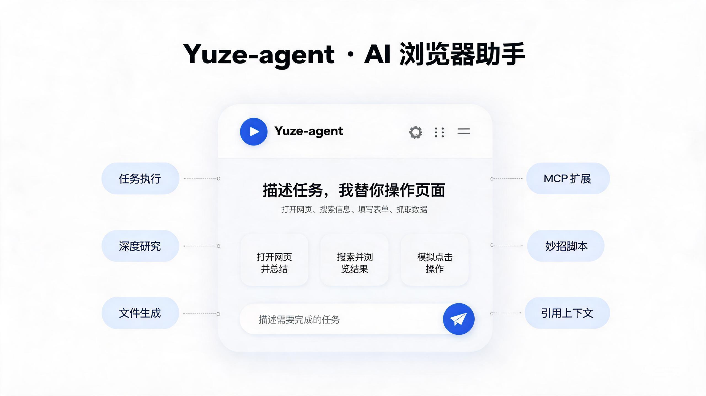
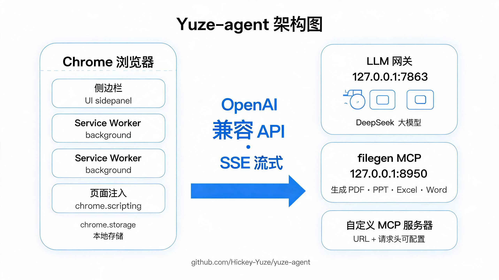
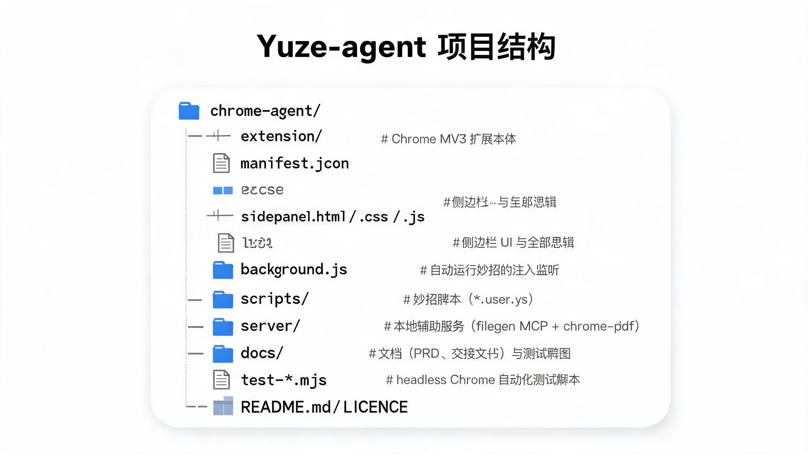

# Yuze-agent

浏览器内的 AI agent：Chrome 侧边栏扩展，用自然语言执行任务——页面操控、截图、引用、技炉脚本、MCP 工具、文件生成。

设计思路是**不自托管模型**：把意图交给 LLM，由它调用一组浏览器工具完成操作；整个实现完全跑在 Chrome 扩展里，不依赖原生二进制或 Playwright。

> 作者：Yuze（[Hickey-Yuze](https://github.com/Hickey-Yuze)） · 版本 0.5.0 · License: MIT



## 功能一览

- **问答 / 任务两种模式**：问答直连 LLM；任务模式启用工具调用循环（最多 300 轮兜底，连续无新进展自动停止）。
- **流式思考**：思考过程（reasoning）实时流式渲染为可折叠区块，回答流式输出且不闪烁。
- **页面操控**：`chrome.debugger`（原生 CDP）读写当前标签页，无需额外调试端口。
- **引用**：`@` 引用菜单（打开的标签页 / 收藏 / 本地文件 / 文件夹）；引用条随标签页自动切换（可开关）。
- **截图**：一键截取当前页面并作为引用发送。
- **技炉**：内置 33 个精选技炉 + 1688 个从技炉广场导入的技炉（网页脚本 432 个，其余为提示词/任务），技炉库支持滚动分批渲染与搜索，脚本类支持「手动运行 / 自动运行」（按适用网站自动注入），详情页可编辑脚本代码与适用网站。
- **MCP 服务器**：可视化配置多个 MCP（Streamable HTTP + 自定义 Headers），自动发现工具并挂载为 `mcp_*` 工具。
- **文件生成**：PDF / PPT / Excel / Word / 图片 / 代码文件（`save_js`），产物以卡片形式回传并可下载。
- **多提供商**：可添加多个 OpenAI 兼容提供商，「获取模型」自动拉取模型列表。
- **历史与搜索**：按当前页面分组的会话抽屉、会话删除、全文搜索。

## 架构



文字版：

```
侧边栏 UI (sidepanel.js)
   │  OpenAI 兼容 /chat/completions（带 tools，SSE 流式）
   ▼
LLM 提供商（默认本机网关 http://127.0.0.1:7863/v1）
   │  tool_calls
   ▼
chrome.debugger → 原生 CDP → 当前标签页
   │
   ├→ MCP 服务器（Streamable HTTP）→ mcp_* 工具
   └→ filegen MCP (127.0.0.1:8950/mcp) → 文件卡片
```

- 对话循环、工具调用全部在侧边栏页面里执行（不受 service worker 30 秒休眠影响）。
- 浏览器操控走 `chrome.debugger`（CDP 1.3），**不需要**给 Chrome 加 `--remote-debugging-port`，也不需要 native messaging host。

## 安装（开发者模式）

1. 打开 `chrome://extensions`
2. 右上角打开「开发者模式」
3. 点「加载已解压的扩展程序」，选择本仓库的 `extension/` 目录
4. 点击工具栏图标打开侧边栏

> 修改 `manifest.json` 的权限后，需要在 `chrome://extensions` 把扩展开关**关掉再打开**（仅点刷新不会重载静态权限）；刷新扩展后需**关闭并重开侧边栏**，否则跑的还是旧页面。

## 配置提供商

齿轮 ⚙ 打开设置弹窗 →「提供商」→ 编辑：

- **本机网关**（默认）：本机 `http://127.0.0.1:7863/v1`，无需 API Key。
- 自定义：任意 OpenAI 兼容 `/chat/completions` 接口，填 API Key、API 地址、模型名；点「获取模型」自动列出可用模型。

Key 保存在 `chrome.storage.local`，只留在本机浏览器里。

## 使用要点

| 功能 | 入口 | 说明 |
|---|---|---|
| 问答 / 任务 | 技能按钮弹窗顶部两卡 | 任务模式才启用工具调用与文件生成；9 个任务点击生成粉色 chip |
| 引用标签页 | 输入框 `@` | 打开的标签页 / 收藏 / 上传本地文件 / 选择本地文件夹 |
| 自动引用 | 引用条右侧开关 | 开启后引用条随当前标签页自动更新 |
| 截图 | 工具栏「截图」 | 截图作为引用随消息发送（需模型支持视觉） |
| 技炉 | 工具栏「技能」→ 技炉面板 | 脚本类详情页「▶ 运行脚本」+ 运行方式手动/自动 + 适用网站编辑 |
| MCP | 设置 → MCP 服务器 | 表单 / JSON 导入、Headers、测试连接、全部/推荐/自定义 Tab |
| 文件生成 | 任务模式对话 | PDF/PPT/Excel/Word/图片/JS 文件，产物卡片可下载 |
| 历史对话 | 顶栏 ☰ | 「与当前页面相关对话」+「全部对话」，可删除，支持搜索 |
| 模型切换 | 输入框底部模型名 | 列表从网关 `/v1/models` 实时拉取 |

## MCP 配置示例（JSON 导入）

```json
[
  {
    "name": "filegen",
    "url": "http://127.0.0.1:8950/mcp",
    "headers": {}
  }
]
```

- 传输：Streamable HTTP（JSON-RPC），Header 用于鉴权（如 `Authorization: Bearer YOUR_KEY`）。
- 工具命名：`mcp_<slug>`，重名自动加序号；连接后自动拉取 tools 列表。
- 「测试连接」会逐个服务器发起 `initialize` 验证连通性。

## 生成文件（PDF / PPT / Excel / Word）

扩展自己不带文档库（省 2.2MB），改成**本机 MCP 服务**：模型调工具，服务返回文件字节，扩展下载并显示卡片。

```
扩展  →  MCP tools/call  →  127.0.0.1:8950/mcp
                              ├─ PDF   : HTML → headless Chrome Page.printToPDF
                              └─ PPT/XLSX/DOCX : pptxgenjs / exceljs / docx
   ←  FILE_JSON{name,mime,size,b64}  ←  chrome.downloads.download  →  文件卡片
```

PDF 走 Chrome 排版引擎（`server/chrome-pdf.mjs`），而不是手写坐标，因此能拿到中文断行与标点挤压、表格跨页重复表头、页脚页码、A4 页边距；Chrome 起不来时自动回退 pdf-lib。headless Chrome 空闲 5 分钟自动退出。

### 启动服务

```bash
cd server
npm install          # 首次
node server.mjs      # 保持运行
```

看到 `filegen MCP → http://127.0.0.1:8950/mcp` 即就绪。

### 文件卡片

生成后对话里出现卡片，`打开` 直达默认应用，`⋯` 菜单：打开文件夹、在默认应用打开、复制路径、另存为…、添加到对话框。

注意：卡片只对**本次运行生成**的文件有效；重开侧边栏后历史卡片仍显示，但打不开（Blob URL 已释放），重新生成即可。

## 项目结构



文字版：

```
Yuze-agent/
├── extension/          # Chrome MV3 扩展本体
│   ├── manifest.json
│   ├── sidepanel.html / .css / .js   # 侧边栏 UI 与全部逻辑
│   ├── background.js   # 自动运行技炉的注入监听
│   └── scripts/        # 技炉脚本（*.user.js）
├── server/             # 本地辅助服务（filegen MCP + chrome-pdf）
├── docs/               # 文档（PRD、交接文档）与测试截图
├── test-*.mjs          # headless Chrome 自动化测试脚本（node test-xxx.mjs）
└── README.md / LICENSE
```

## 开发与调试

- 测试：`node test-<场景>.mjs`（基于 headless Chrome + `Extensions.loadUnpacked` + CDP `Runtime.evaluate` + `Page.captureScreenshot`）。
- 文件生成依赖 filegen MCP（`http://127.0.0.1:8950/mcp`），未连接时任务模式会明确提示工具缺失。
- 会话存 `chrome.storage.local` 的 `sessions` 键，最多 100 条，300ms 防抖落盘。

## 更新记录

### v0.7 — 交互对齐轮

| 改动 | 说明 |
|---|---|
| 流式思考 | `callLLM` 改 SSE（`delta.reasoning_content` → 思考区块、`delta.tool_calls` 按 index 合并）；`updateLive` 只更新最后一条 DOM，杜绝流式闪烁；完成自动折叠可点开 |
| 技炉库 33 个 | 新增 19 个脚本类技炉（b15–b33）；脚本存 `extension/scripts/*.user.js` |
| 脚本运行 | 详情页「▶ 运行脚本」（手动=`chrome.scripting.executeScript`；自动=`background.js` 监听 `tabs.onUpdated` 按适用网站注入）；执行前自动 detach debugger |
| 引用 @ 菜单 | 标签页/收藏/本地文件/文件夹；引用条 chip 化；自动引用开关（随标签页切换） |
| 多提供商 | 设置弹窗化（提供商卡 + 添加 + 技炉/MCP 分组行 + 保存并验证）；MCP 面板（Tab/新增弹窗/Headers/测试连接） |
| 品牌化 | 改名 Yuze-agent，图标/brand.png 更换 |
| 会话抽屉 | 按当前页面分组 + 时间显示 + 单条删除 |

### v0.6 — 技炉库

| 改动 | 说明 |
|---|---|
| 技炉库 | 点 `✨` 打开，左侧导航（全部 / 官方 / 已安装 / 自定义）+ 右侧卡片网格，支持搜索与分类筛选 |
| 技炉详情 | 创建者/更新时间/版本、「试试这样问」示例、适用网站、技炉内容、SKILL.md |
| 创建技炉 | 类型选择（提示词 / 网页脚本 / 任务）→ 对应表单 → 保存进自定义 |
| 交互 | 点击示例或任务项只生成可移除的引用 chip，不直接灌进输入框 |

### v0.5 — PDF 排版引擎

| 改动 | 说明 |
|---|---|
| PDF 换引擎 | `gen_pdf` 改为 HTML + headless Chrome `Page.printToPDF`；中文字体、断行、表格跨页重复表头、页码全部由浏览器排版引擎负责 |
| 兜底 | Chrome 不可用时回退 pdf-lib 手写排版（`makePdf`） |
| 进程管理 | headless Chrome 复用单实例，空闲 5 分钟自动退出 |

### v0.4 — 文件产物

| 改动 | 说明 |
|---|---|
| 文件生成走 MCP | 新增 `server/server.mjs`，把 pdf-lib / pptxgenjs / exceljs / docx 包成 4 个 MCP 工具，扩展不增体积 |
| 文件卡片 | 生成后下载并由 `chrome.downloads` 接管，对话里出现卡片（图标/文件名/大小/打开） |
| 技能项升级 | 「生成 PDF/PPT/Excel/Word」改为调用 MCP 工具，并自动切任务模式 |

### v0.3 — 能力面扩展

模型切换（`/v1/models` 实时拉取）、停止按钮、引用、截图、6 个预设技能、MCP 多服务器、历史抽屉与全文搜索。

### v0.2 — UI 重构 + 导航修复

工具调用折叠摘要、助手消息去气泡、错误合并去重；导航改 `chrome.tabs.update` + 等 `complete` + 重连，修复 `Detached while handling command`。

## 已知限制

- 附加调试器时 Chrome 顶部会出现「正在调试此浏览器」提示条，属正常现象。
- `chrome://`、Web Store 等受保护页面无法附加。
- 侧边栏关闭后对话历史保留，但正在进行的工具调用会中断。
- 截图走 `image_url` 多模态消息，需要模型支持视觉。

## 许可证

[MIT](./LICENSE) © Yuze
