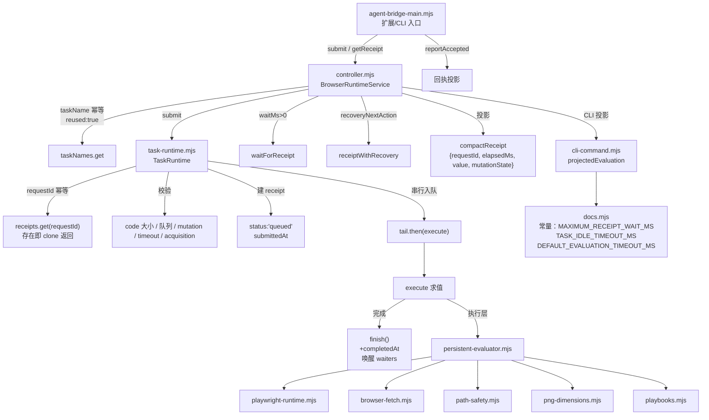
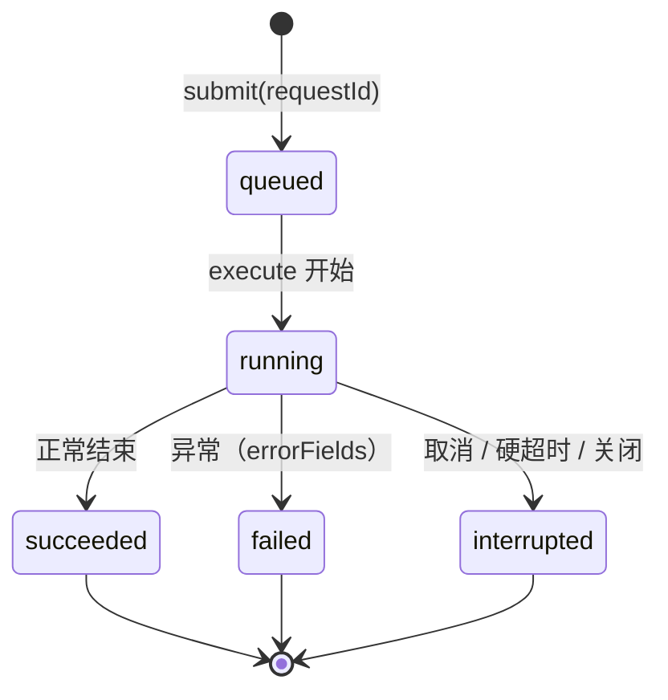

# Tabbit 运行时调用关系图（REA 静态分析）

来源：`/Applications/Tabbit Browser.app/Contents/Frameworks/Tabbit Browser Framework.framework/Versions/1.18.20.0/Resources/TabbitDance/runtime/src`（36 个 .mjs，REA 扫描 45,546 个 AST 节点、468 条 finding、1,482 条 call-flow 关系）。

## 一、调用链

## 二、receipt 状态机

`finish()` 是唯一出口：`Object.assign(receipt, fields, {completedAt})` → 持久化 → 唤醒该 requestId 的所有 waiter。

## 三、六条可复刻语义

| # | 语义 | 实现位置 | Yue-agent 对照 |
|---|------|----------|----------------|
| 1 | **请求级幂等**：同 requestId 重复 submit 直接返回原 receipt，不重复执行 | `task-runtime.mjs` `submit()`：`receipts.get(requestId)` 命中 → `clone(existing)` | ✅ offscreen `start()` 同 requestId 返回 `{duplicate:true}` |
| 2 | **任务级幂等**：同 taskName 复用同一任务，返回 `reused:true` | `controller.mjs` `taskNames.get(taskName)` | ✅ 会话级单任务 |
| 3 | **终态立即返回**：已是 succeeded/failed/interrupted 直接返回，不挂 waiter | `waitForReceipt()` 开头 `TERMINAL_STATUSES.has(...)` | ✅ 0.5.5 侧边栏 `completedAt + taskStatus` 判终态复位 |
| 4 | **超时 resolve 而非 reject**：到点返回当前 receipt（可能仍是 running） | `setTimeout(() => resolve(clone(current)))` | ✅ 12 秒回执兜底后回查 agentRun |
| 5 | **串行队列**：同一 TaskRuntime 的投递排队执行 | `this.tail = this.tail.then(() => execute(...))` | ✅ 后台单循环 |
| 6 | **mutationState 决定持久化**：只有可能改浏览器状态时才落盘 receipt（崩溃后可查） | `persistReceipt()`：`mutationState !== 'possible'` 直接 return | ⚠️ 本地恒落盘，仅作记录 |

## 四、错误恢复投影

`recoveryNextAction(receipt)` 按状态给出下一步：

- `queued` / `running`：**等，别重投**（"Wait for this receipt using the same request ID and task name; do not resubmit the program."）
- `failed` + `mutationState:'possible'`：可能已执行部分动作，先用只读任务核对可见状态，再考虑重试
- `failed` + `none`：程序有错，改代码换新 requestId
- `interrupted` + `taskTerminated`：硬超时已杀执行器，保留标签页，新建只读任务并 resume groupId
- `interrupted` + `possible`：同 failed 的可能已变更
